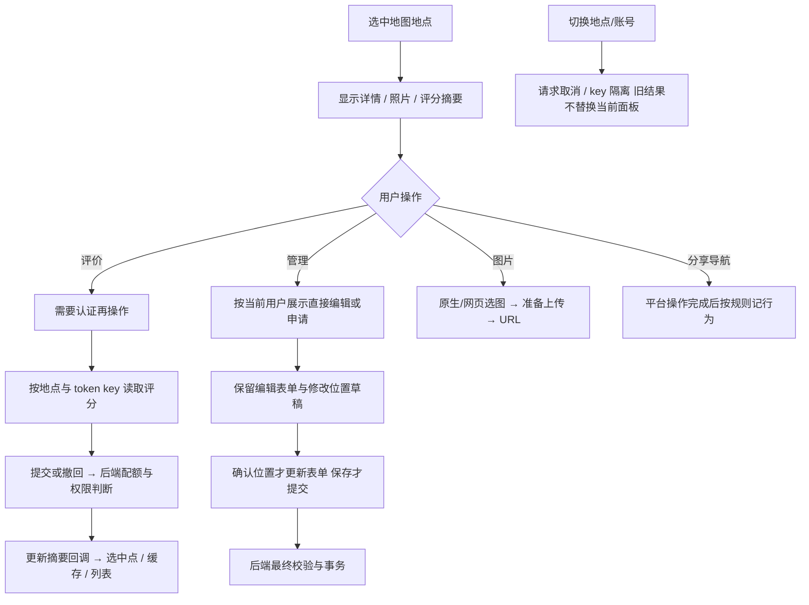

# 地点详情、编辑与评分

components 下 AddPlaceForm、ManagePanel、CategorySelector、PlaceDetailPanel、PlaceImageInputs、PlaceRatingPanel、CommentPanel 收拢地点交互；hooks/usePlaceRating 处理评分状态与请求；rating.js 是展示与避雷纯逻辑；placeBehavior.js 记录有效用户操作与分享。shareCard.js 画地点分享卡片（以静态地图为中心、外围信息框与二维码，横竖两版），hooks/useShareCard 管生成/缓存/分享；地图来自后端 `/api/amap/staticmap`，输出走 platform/share 的图片分享与保存。地图渲染仍在 map，网络封装在 api/client，照片选择和压缩在 platform/mediaPicker。

| 方案 | 对照与约束 |
| --- | --- |
| 评分展示规则集中 rating.js | 须与后端 <2.5/无分看标签保持一致，不能各组件写一套 |
| 编辑暂存与服务端提交分开 | 取消选点不应修改服务器，也不应清空其他字段 |
| 身份决定可用操作，后端授权 | 隐藏按钮不能作为真正权限检查 |
| 行为只记有效结果 | 点击菜单/取消分享不等于导航成功或收到分享，不补造反馈 |

案例见 [TEST_CASES.md](TEST_CASES.md)，已有 `test:rating` 与位置浏览器集成；后端另测评分、申请、图片和分享。历史 `65ce2d4`、`ed3b2f9`、`2bc8c5e`；待办 PLC-F01 见 [清单](../../../doc/HISTORY_AND_TODO.md)。
