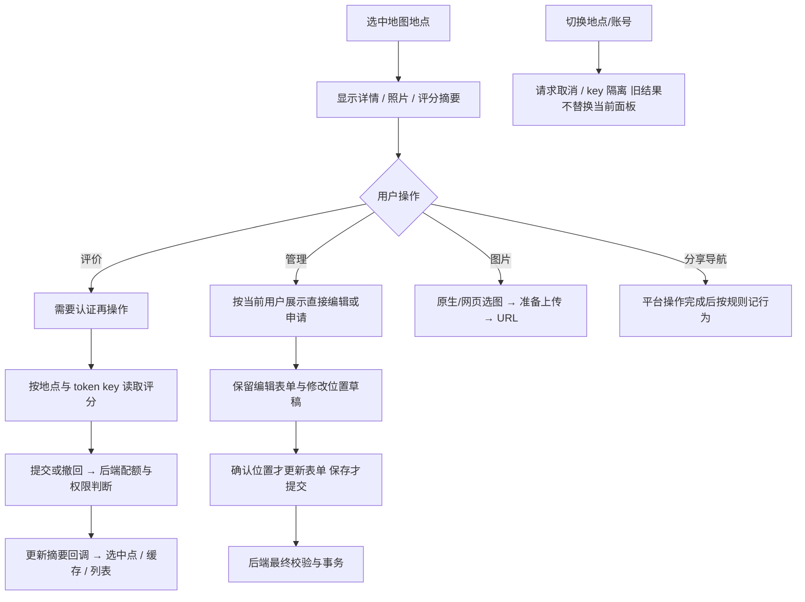

# 地点详情、编辑与评分

地点列表（`PlaceListView.jsx`，`GET /places/list`）：店名、简介（Markdown，CSS 只显示前三行）、第一张图与评价，按综合评价（评价少时向均线收缩）排序，登录后再结合口味相近的人的评价。条目不带坐标、地址和距离，只链接 `/p/:id`，点开在地图上打开。地图上的列表模式（`map/MapListMode.jsx`）与可直接打开的 `/places` 页（`PlaceListPage.jsx`）共用它。

“预计你会给”的分数数字在网页地点列表、地点卡和评价面板使用 `RatingPredictionValue` 加粗放大，保留现有的一位小数。iOS 原生地点卡通过可选的 `subtitleEmphasis` 字段强调同一个数值，字幕仍可按普通文本读取。

筛选（`placeFilter.js` + `components/PlaceFilterPanel.jsx`，规则与后端 `placeList.js` 的 `matchesFilter` 一致）：标签三态，点一下变绿（`tags`，包含，多个绿色命中任一即可），再点变红（`excludeTags`，排除，命中任一就不显示），再点取消，即（绿 OR 绿）−（红 OR 红）；列表接口参数为 `tags` / `excludeTags`。人均用双滑块拉杆（`components/forms/RangeSlider.jsx`，0–200 元，拉到最右为不限），设了人均范围时没填人均的地点不显示。地图筛选与列表模式共用 MapView 里的同一份筛选，只由筛选面板设置；iOS 原生控件接管时筛选面板是协议 v14 的原生玻璃面板（`filterChromeSheet.js`：标签为 chips，人均为几档常用范围）。AI 搜索读出的筛选（后端 `discovery/services/searchFilter.js`，含排除标签）只在后端套用到 AI 推荐的候选上，前端在推荐上方用一句话说明（`describePlaceFilter`），不改地图筛选。常用标签由 `backend/seeds/categories.json` 的 `is_common` 决定（启动时同步到 Category 表）。分类目录由 `categoryDirectory.js` 整页只读一次。

地区筛选（2026-11-11）：筛选面板有省 / 市 / 区三级联动下拉（`placeRegions.js` 整页只读一次 `GET /places/regions`，失败后下次再请求；筛选值 `province` / `city` / `district` 在 `placeFilter.js` 里规整，下层要有上层），选中后 MapView 把地图移到该地区的范围（`regionBounds`），列表接口带同名参数。iOS 原生筛选面板用协议 v16 的 `menu` 分组画成下拉菜单（`filterChromeSheet.js`）。地图上点开地点时，交互反馈附带 `placeFilterSnapshot(filter)`（规整后的筛选，没有生效的条件时为 null），后端 `community.js` 的 `mapClickFilter` 按同样规则校验。

“待探索”（`rating.js` 的 `EXPLORE_TAG`，与后端 `ratingWarning.js` 一致）：还没去过、先标记的地点。添加地点表单有“待探索”勾选（iOS 原生表单的 `exploreTag` 开关，`toggleCategoryTag` 加 / 去标签），勾选后不需要评价、创建时不写创建者评分；`isUnexploredPlace`（带标签且 `rating_count` 为 0）时地图标记用问号图标，有人评价后按普通地点显示。

图片（`components/PlaceImageInputs.jsx`）可一次多选，逐张处理、上传，失败的可一键重试。iOS App 的添加 / 修改地点改为原生 SwiftUI 表单（`hooks/useNativePlaceForm.js` + `platform/nativePlaceForm.js` + `ios/App/App/NativePlaceFormPlugin.swift`）：新增地点时先停在屏幕下方三分之一，用户往上拉开；图片用系统相册（可多选）或相机，原生缩到 2560 内编码后逐张交给网页上传；提交、删除也交回网页，走 MapView 原有的流程。“在地图上修改位置”结束原生表单（带回填写内容），网页打开全屏选点，选好后重新打开。添加地点的本机草稿与网页表单相同（关掉时存回 `addPlaceDraft`）。网页的添加地点面板在窄屏同样先只露出下方三分之一（`ResponsivePanel` 的 `snap="third"`）。添加地点时，首次有效点选立即结束选点模式，标记固定在所选坐标（`map/addingPin.css`）；打开表单不再自动平移地图，表单打开后的地图点击也不会改写坐标。取消后可以重新选点。浏览器回归：`node scripts/testing/test-add-place-pick-browser.mjs`（AMap / HTTP 边界替身，实际 iOS 触摸另验）。

住民评论（2026-11-25，`placeComments.js` + `hooks/usePlaceComments.js` + `hooks/usePlaceCommentForm.js` + `components/PlaceCommentList.jsx`，后端规则见 [community 文档](../../../../backend/modules/community/doc/README.md) 与 [初筛](../../../../backend/modules/places/doc/placeModeration.md)）：每人每店一条，与描述分开保存，显示时每条一行「住民名：评论」接在描述末尾：网页详情面板、窄屏店卡展开后的完整描述、iOS 原生店卡的简介（`appendCommentsToDetail`，纯文本 `detail` 与行内 Markdown `detailMarkdown` 各一份，评论原样转义，按原生 2000 / 4000 字上限截断并注明还有几条）。评论来自 `GET /places/:id` 的 `comments`：地图快照补全的地点自带，搜索、列表、收藏等来源的地点没有这个字段时再读一次单店详情（与补全共用 MapView 的 `loadPlaceDetail` 缓存）；自己的评论在 AI 初筛（`checking`）时隔 5 秒重读，最多 3 次。自己那条未公开时后面跟小字“审核中”或“未通过审核”，别人看不到。宽屏小卡的摘要在有评论时也显示“展开”。列表最后一行是“写评论 / 修改我的评论”，网页店卡的“更多”菜单与 iOS 原生店卡展开后的详情（一行 `comment`）也有这个入口；高德临时地点、展会地点、审核中或未通过的地点、封禁账号不显示。写评论复用编辑地点的面板：网页 `ManagePanel` 的 `mode="comment"`，iOS 原生地点表单的 `comment` 模式（`NativePlaceFormPlugin.swift`，只有评论框与评价四档，`values` 是 `{ comment, rating }`，已有评论时可删除），都只有评论和评价两项，打开时预填自己的评论和评价。评论去掉空白至少 2 个字、最多 200 字，换行折成空格；评价必填，与当前评价不同时先走原有评价接口（单票与每日配额照旧），再提交评论，成功后提示“已发布”或“已提交审核”。

iOS 原生评价与打卡面板（2026-11-20，控件协议 v19）：iOS 原生控件接管时，店卡的「评价」与「打卡」不再打开网页面板，而是与筛选、收藏同一种 SwiftUI 玻璃面板（`MapChromeMenuPanel`）。`ratingChromeSheet.js` 生成评价面板快照（档位大字 `stat`、低分风险与预计你会给 `note`、分布条 `bars`、两列选项格 `grid`，未登录 / 撤回 / 重试是底部胶囊按钮），点按回传 `rate:<分数>` 等行 id，MapUI 用 `ratingActions.js`（`chooseRating` / `withdrawRating`，网页评价面板也用它）执行；失败原因写进面板提示（网页 toast 会被原生面板盖住）。打卡的表单状态与提交移到 `hooks/usePlaceCheckIn.js`，由 MapUI 持有，网页 `PlaceCheckInPanel` 与原生 `checkInChromeSheet.js` 用同一份：补充描述是原生多行输入框（每次改动经 `input` 事件回传），评分是标签，照片是缩略图（`imageThumbnailDataUrl` 生成的小 JPEG，原生不拿文件名），提交、选图期间面板 `locked`，关闭钮、下滑与点地图都不关闭、也不把触摸交给地图。

components 下 AddPlaceForm、ManagePanel（含评论模式）、CategorySelector、PlaceDetailPanel、PlaceCommentList、PlaceImageInputs、PlaceRatingPanel、CommentPanel（管理员的修改记录，与住民评论无关）收拢地点交互；hooks/usePlaceRating 处理评分状态与请求；rating.js 是展示与避雷纯逻辑；placeBehavior.js 记录有效用户操作与分享；placeDescription.js 是描述最少字数（15 字，不算空白，与后端 `PLACE_DESCRIPTION_MIN_LENGTH` 同规则）：添加表单在描述下显示已写字数，提交前拦下太短的描述；iOS 原生表单提交由 MapUI 同样检查；编辑与修改申请只在改了描述时检查（MapView `rejectShortDescription`）。addPlaceDraft.js 是添加地点表单的本机草稿（每次改动写入 localStorage，按账号隔离，面板怎么关都不丢，提交成功或清空才删除；坐标和地址跟这次打开的位置走，从另一个高德地点收录时只提示可恢复，App 内同样走这份网页表单）。editEvidence.js 在保存前预览修改记录（只含描述里新增的文字，与后端 `placeEditDiff.js` 同规则，`test-edit-evidence` 对照），规则见后端 [编辑文本证据](../../../../backend/modules/ratings/doc/EDIT_TEXT_EVIDENCE.md)。useDetailInterest + detailTiming 记录详情打开与前台浏览时长（弱兴趣信号），useVisitEvidence + visitEvidence 在前台按定位推断到访并询问“是否去过”（坐标不离开状态机），二者规则见后端 [兴趣信号](../../../../backend/modules/preferences/doc/INTEREST_V3.md)。shareCard.js 画地点分享卡片（以静态地图为中心、外围信息框与二维码，横竖两版），hooks/useShareCard 管生成/缓存/分享；地图来自后端 `/api/amap/staticmap`，输出走 platform/share 的图片分享与保存。地图渲染仍在 map，网络封装在 api/client，照片选择和压缩在 platform/mediaPicker。

| 方案 | 对照与约束 |
| --- | --- |
| 评分展示规则集中 rating.js | 须与后端 <2.5/无分看标签保持一致，不能各组件写一套 |
| 编辑暂存与服务端提交分开 | 取消选点不应修改服务器，也不应清空其他字段 |
| 身份决定可用操作，后端授权 | 隐藏按钮不能作为真正权限检查 |
| 行为只记有效结果 | 点击菜单/取消分享不等于导航成功或收到分享，不补造反馈 |

案例见 [TEST_CASES.md](TEST_CASES.md)，已有 `test:rating`（含原生评价 / 打卡面板快照 test-native-place-sheets）、`test:place-draft` 与位置浏览器集成；后端另测评分、申请、图片和分享。历史 `65ce2d4`、`ed3b2f9`、`2bc8c5e`；待办 PLC-F01 见 [清单](../../../doc/HISTORY_AND_TODO.md)。
