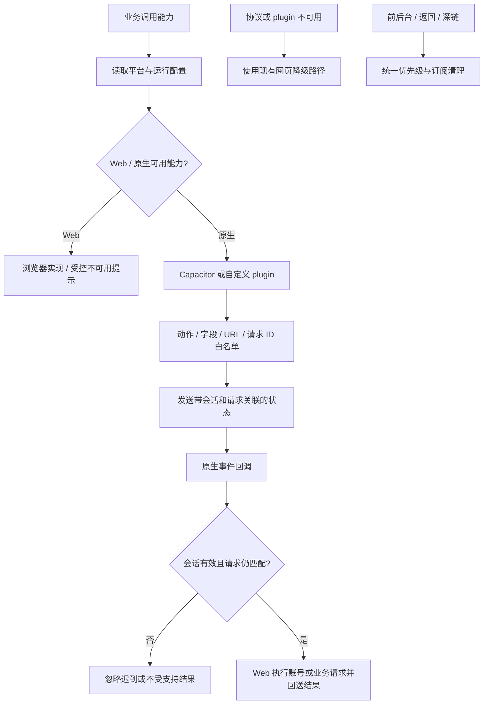

# 平台能力与原生协议

业务通过本目录访问配置、导航/返回、凭证、定位、媒体、分享、生命周期、本机草稿和原生桥接；index.js 是能力导出入口，允许现有消费者直接导入单项文件。nativeMapChrome/nativeSettings 是 JS 会话，Swift 实现在 ios 工程；Android 定位走应用内高德插件 AMapLocation（android/app/.../AMapLocationPlugin.java，高德失败时插件改用系统定位），iOS 用 @capacitor/geolocation；nativeShell 负责启动与深链。

`privacyConsent.js` 保存本机隐私选择与政策版本。缺失、损坏、旧版本记录均需重新确认；存储异常时保留本次选择。`main.jsx` 在同意前不导入业务 App、不初始化原生容器、不加载字体 CDN；`amapLoader.js` 拒绝未同意时的加载请求，包括已有 `window.AMap` 的情况。拒绝界面可独立阅读政策并重新选择。验证入口为 `npm run test:privacy`，它不访问真实高德或用户账号。

| 当前方案 | 对照与边界 |
| --- | --- |
| 平台差异收口 | 各业务自行判断 UA 会扩散不一致；当前仍保留认证特有 XHR 兼容路径 |
| JS 执行业务，原生请求动作 | 不把凭证和任意 URL 操作权交给原生面板输出；字段清洗与会话 ID 都需保留 |
| WGS84/GCJ-02 单点转换 | 坐标转换不是按“是否中国境内”的粗矩形猜测，沿用 chinaRegion 与对应测试 |
| 缺能力降级 | 能力不可用不等于业务数据无效；不要改为静默成功 |

聚合点的原生显示使用独立的 `nativeClusterMarkers.js` / WebKit `foodMapClusters` 带回复通道（协议 v2），不改变工具栏协议。独立本机偏好 `clusterGlass` 默认关闭。`open` 获取原生会话，`frame` 发送显示字段、每个图形的局部可见矩形和递增帧序号，`close` 确认清除；一次一帧，后续积压合并为最新状态。首次回执后隐藏 PNG，已确认图形在裁切、暂时空帧和切页时持续保留材质所有权；桥接等待覆盖 800ms 显示租期，短暂忙碌不直接切换材质。超时后到达的握手结果仍负责关闭原生会话。清除失败时等待原生租期结束，再恢复 PNG；原生拒绝过期发送时间和旧会话，后台与网页重载清空显示。v1 旧壳使用 PNG，避免忽略可见片段后覆盖网页前景。对应测试纳入 `test:map`。

已有 test:platform / test:native-chrome（含设置），真机另看 [原生文档](../../../native/doc/README.md)。案例见 [TEST_CASES.md](TEST_CASES.md)，待办 PLT-01 / PLT-02 见 [清单](../../../doc/HISTORY_AND_TODO.md)。
