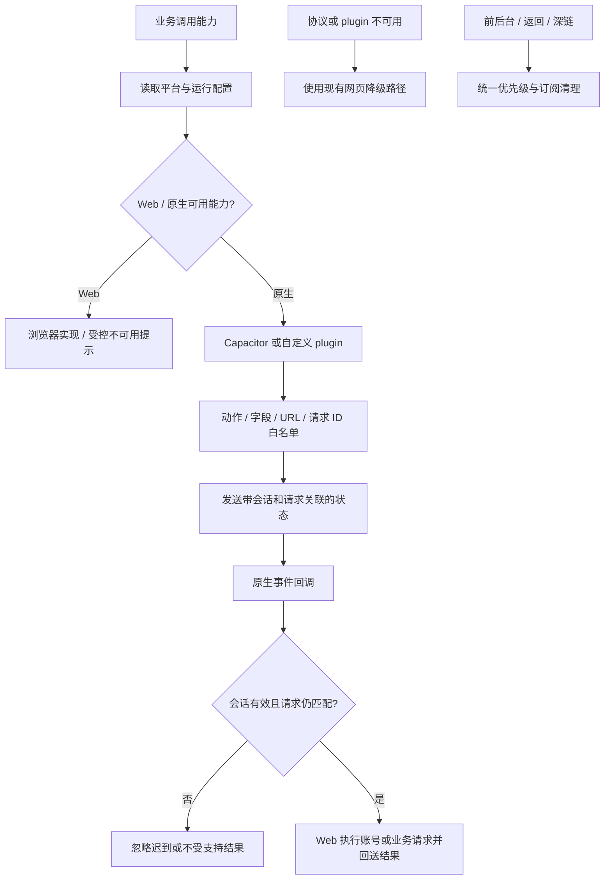

# 平台能力与原生协议

业务通过本目录访问配置、导航/返回、凭证、定位、媒体、分享、生命周期、本机草稿和原生桥接；index.js 是能力导出入口，允许现有消费者直接导入单项文件。nativeMapChrome/nativeSettings 是 JS 会话，Swift 实现在 ios 工程；nativeShell 负责启动与深链。

| 当前方案 | 对照与边界 |
| --- | --- |
| 平台差异收口 | 各业务自行判断 UA 会扩散不一致；当前仍保留认证特有 XHR 兼容路径 |
| JS 执行业务，原生请求动作 | 不把凭证和任意 URL 操作权交给原生面板输出；字段清洗与会话 ID 都需保留 |
| WGS84/GCJ-02 单点转换 | 坐标转换不是按“是否中国境内”的粗矩形猜测，沿用 chinaRegion 与对应测试 |
| 缺能力降级 | 能力不可用不等于业务数据无效；不要改为静默成功 |

已有 test:platform / test:native-chrome（含设置），真机另看 [原生文档](../../../native/doc/README.md)。案例见 [TEST_CASES.md](TEST_CASES.md)，待办 PLT-01 / PLT-02 见 [清单](../../../doc/HISTORY_AND_TODO.md)。
