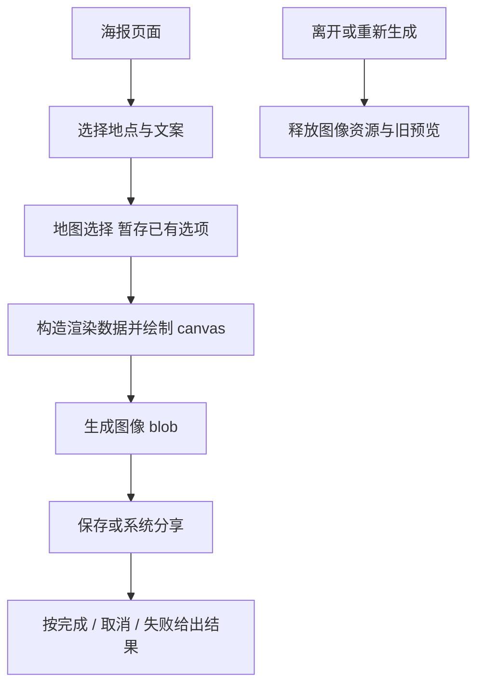

# 地图海报

PosterExportPage.jsx 管理选择地点、文案和导出；rendering/posterCanvas.js 绘制图片。地图选择复用 MapView，保存/分享调用 platform。日记首图的 journey/cover 保留独立，因为数据和隐私约束不同。

当前将 UI 和 canvas 分开，对照在组件内混写绘制循环更便于测试；不在整理时改变字体、坐标或图片缩放。案例（待独立自动化）：PST-C01 空选择与多地点；PST-C02 长店名、中文与 emoji 不越界；PST-C03 图片加载失败仍给可解释结果；PST-C04 取消系统保存不报成功，重复生成不显示旧 blob；PST-C05（人工真机）iOS/Android 相册权限与实际导出图。见 PST-01 的 [清单](../../../doc/HISTORY_AND_TODO.md)。
