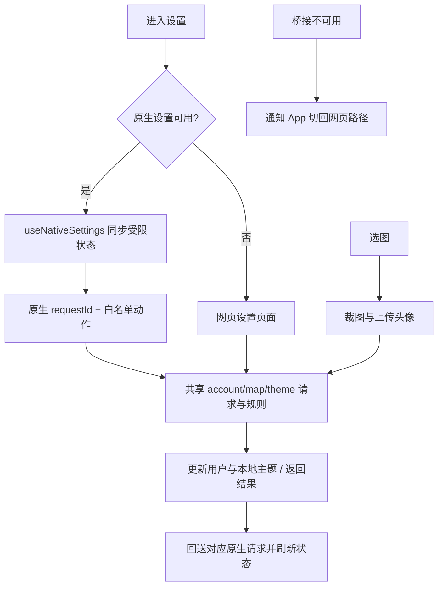

# 住民设置

Settings.jsx 为主页和原生设置驱动入口；EditAvatar/Username/Password、PersonalizeMap、CustomThemes、MotionSettings 是页面；accountSettings/mapSettings/themeOptions 共享网页与原生业务；useNativeSettings 建立桥接会话；media/cropImage 是裁图工具。

共享业务函数可避免网页/原生保存规则漂移；原生是展示与输入，账号请求仍在 Web。头像裁切与地点图片处理目的不同，不合并为统一“压缩全部图片”。已有 test:native-chrome 中设置协议测试，不能替代真实头像、键盘与 SwiftUI 验收。

案例：SET-C01（已有桥接逻辑）错误/过期 requestId 不更新当前会话；SET-C02（待浏览器）更新密码/用户名失败保留可重试输入，成功更新 App 用户；SET-C03（人工真机）头像相机/相册/取消/裁剪、键盘与原生关闭；SET-C04（待专项）切账号时旧设置回调不写新用户。历史 c19d13b、d285076；待办 SET-01 见 [清单](../../../doc/HISTORY_AND_TODO.md)。
