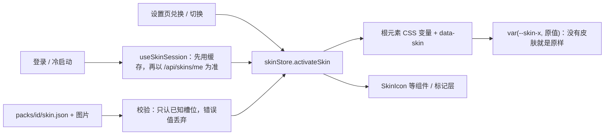

# 主题皮肤

住民用皮肤兑换码解锁（后端见 [皮肤与兑换码](../../../../backend/modules/skins/doc/README.md)），在“住民设置 → 主题皮肤”里兑换和切换（iOS 原生设置首页的这一行打开同一个网页页面）。当前这套样式就是“默认”：没有皮肤、或皮肤缺某个素材时，那个位置保持原样。

| 文件 | 职责 |
| --- | --- |
| `slots.js` | 可替换位置（槽位）清单：类型、CSS 变量、底纹标记、继承关系 |
| `registry.js` | 校验皮肤包、登记、按深浅色取值（纯函数） |
| `packs.js` | 构建时收集 `packs/<id>/skin.json` 与图片（`import.meta.glob`，只由 App 引入） |
| `skinStore.js` / `useSkin.js` | 正在使用的皮肤；标记层等非组件代码也从这里取图 |
| `apply.js` + `skin.css` | 写根元素 CSS 变量与 `data-skin`；只在有皮肤时生效的样式 |
| `SkinIcon` / `SkinAvatar` / `SkinDecor` | 图标、默认头像与头像框、卡片边框与底栏两端装饰 |
| `nativeSkin.js` | iOS 原生 SwiftUI 控件用的图标与装饰（直接提供 PNG 等位图地址） |
| `useSkinSession.js` / `skinApi.js` | 登录后同步服务器上的皮肤，本机按住民缓存 |

## 不改默认样式的做法

- 行内样式写成 `var(--skin-…, 原来的值)`；没有皮肤时根元素上没有这些变量，取到的就是原值。
- 图标用 `<SkinIcon slot="…">原来的图标元素</SkinIcon>` 包住：皮肤没有这张图（或图片加载失败）时原样返回 children。
- `skin.css` 的规则都挂在 `:root[data-skin]` 上，默认样式时不生效。

## 液态玻璃

App 内的玻璃材质（`overlay.css`，iOS 与安卓）以 `!important` 固定底色、边框与阴影，皮肤不改玻璃本身：

- **iOS 永不叠加底纹**（`texture: true` 的槽位不写变量），保持玻璃通透；图标、评分表情、头像框、两端装饰、选中底座照常替换。玻璃底部面板上也不画主题边框。
- **iOS 26 起的原生 SwiftUI 控件**（工具栏、定位圆钮、上滑“更多功能”、地点卡片）通过原生控件协议 v8 使用 `slots.js` 里标了 `native` 的槽位：功能图标、评价表情、默认头像与头像框、两端装饰、选中底座、选中色。底纹、底色、边框与主题边框从不交给原生。图片由 `nativeSkin.js` 直接提供 PNG 地址（兼容 jpg / jpeg / webp / gif），支持 App 包内资源与构建时内联的 data URL，无需画布转换；缺图或读不到时回到 SF Symbol。原生两端装饰、底座的位置规则与网页相同；关闭钮、导航等地点卡片按钮用 `cardActions.*`，原生工具栏的“日记 · 同好”用 `toolbar.icons.journey`。
- **安卓**在玻璃底色之上叠一层底纹（`skin.css` 中 android 开头的规则），模糊与边缘折射保留。
- **网页**没有玻璃，全部槽位生效。

## 制作一套皮肤

1. 复制 `packs/_template` 为 `packs/<id>`（小写字母、数字、连字符），将 PNG 素材放进去，在 `skin.json` 里按相对路径填写，例如 `"toolbar": { "icons": { "more": "icons/more.png" } }`；不需要的槽位留 `null`。
2. 在后端 `backend/modules/skins/catalog.json` 登记 `{ "id": "<id>", "name": "显示名" }`。
3. `npm run test:skins` 检查 id 与槽位；开发环境控制台会提示无效值或找不到的图片（这些槽位保持默认）。
4. 管理后台“皮肤兑换码”为这套皮肤生成兑换码。

### 美术交付

- 素材统一按 **PNG** 交付，文件扩展名使用小写 `.png`；图标、表情、头像框、标记与装饰保留透明背景。网页、安卓和 iOS 共用同一套文件。
- 按下表显示尺寸的 **3 倍像素**导出，例如 24px 图标导出为 72×72 PNG，40×40 装饰导出为 120×120 PNG；`skin.json` 的 `width` / `height` 仍填写显示尺寸。
- `iconRendering: "template"` 的功能图标使用 PNG 的透明度作为形状，图形区域保持不透明、背景透明；彩色素材使用 `original`。
- 九宫格边框的 `slice` 按导出 PNG 的实际像素填写，`width` 按显示宽度填写；例如导出图角宽 30px、显示角宽 10px，填写 `slice: 30, width: 10`。
- 设置页预览图 `preview` 也使用 PNG，建议 3:2。其他位图格式 jpg / jpeg / webp / gif 保留兼容；SVG 不再导入或转换，旧引用需改为真实导出的 PNG 文件和 `.png` 路径。

## 浅色与深色模式

- `dark` 里可以写同样结构的覆盖值，深色模式时生效（例如深色卡片底色、夜间版纹理、夜间版装饰与表情）。没覆盖的槽位沿用浅色的值，切换深浅色时网页与 iOS 原生控件都立即换成对应的值。
- `iconRendering: "template"`：功能图标（`cardActions.*`、`toolbar.icons.*`、`expanded.panel.icons.*`）只取 PNG 的透明度形状，按当前文字颜色上色——浅色模式深色、深色模式浅色，选中、禁用、主按钮反色也自动跟随，所以一套单色图标同时适配两种模式（网页用 CSS 蒙版，原生用 template 渲染）。评价表情、头像、标记、装饰始终按原色显示，需要夜间版时写进 `dark`。
- 默认 `original`：图标按原色显示，适合彩色图标；深色模式下看不清的请在 `dark` 里给另一套。
- 原色素材建议留透明底、深浅底上都试一下：网页卡片与面板在深色模式是深底，iOS 原生玻璃在深色模式偏暗。

## 槽位

| 位置 | 槽位（skin.json 路径） | 类型 | 建议素材 |
| --- | --- | --- | --- |
| 地点卡外框 | `placeCard.background` / `borderColor` | 颜色 | |
| | `placeCard.borderWidth`（0–12）/ `radius`（0–40） | px | |
| | `placeCard.shadow` | box-shadow | |
| | `placeCard.texture` + `textureSize` | 图片 + background-size | 可平铺淡纹理（透明度做进图里，约 5%–8%） |
| | `placeCard.frame` | `{ image, slice, width, outset, repeat }` | 九宫格主题边框，四角含圆角；`slice` 是图里角的像素，`width` 是显示宽度 |
| 评分条 | `rating.strongYes` / `aboveAverage` / `belowAverage` / `strongNo` / `none` | 图片 | 同一角色的连续情绪（强烈推荐 → 强烈拒绝，外加“还没评价”），正方形透明底，显示 20–24px |
| 卡片操作按钮 | `cardActions.navigate` / `share` / `favorite` / `favoriteActive` / `edit` / `create` / `details` / `report` / `close` | 图片 | 统一画风的功能图标，显示 20px（关闭 18px）；收藏前后两态；`create` 是未收录地点的“添加”；`details` 只在网页卡片，`report`（举报）只在 iOS 原生卡片 |
| | `cardActions.buttonBackground` / `buttonBorderColor` | 颜色 | |
| 底部功能栏 | `toolbar.background` / `borderColor` / `selectedColor` | 颜色 | 选中色用于选中按钮的图标与文字 |
| | `toolbar.texture` + `textureSize` | 图片 | 浅底纹 |
| | `toolbar.ornamentStart` / `ornamentEnd` | `{ image, width, height, x, y }` | 两端装饰；以底栏左上 / 右上角为原点，x 向内、y 向下，默认 40×40、y −20（坐在上沿） |
| | `toolbar.selectedPedestal` | `{ image, width, height, y }` | 选中时亮起的小底座，画在图标后面，y 为相对按钮中心的下移量 |
| | `toolbar.icons.more` / `favorites` / `journey` / `add` / `addCancel` / `search` / `alongRoute` / `locate` / `login` | 图片 | 显示 24px；`login` 是未登录时的账号图标；`journey` 只在 iOS 原生工具栏出现；`locate` 是定位圆钮 |
| 底栏展开状态 | `expanded.search.*`、`expanded.panel.*`（background / borderColor / texture / textureSize） | 同上 | 搜索框与“更多功能”、账号菜单面板；边框和底纹不填时延续底栏 |
| | `expanded.panel.icons.alongRoute` / `random` / `journey` / `dinners` / `poster` / `admin` / `guide` / `feedback` | 图片 | “更多功能”各行的图标：网页面板默认没有图标，皮肤提供时显示在文字前（22px）；iOS 原生抽屉代替圆形里的 SF Symbol（28pt） |
| 图标画法 | `iconRendering` | `original` / `template` | 见上文“浅色与深色模式” |
| 账号入口 | `account.defaultAvatar` | 图片 | 没有上传头像时的默认头像，正方形 |
| | `account.avatarFrame` | `{ image, scale }` | 主题头像框，中间透明，比头像大 `scale` 倍（默认 1.3）；住民自己的头像保留 |
| 标记点与聚合点 | `markers.place` / `avoid` / `cluster` | 图片 | 显示 36×43（聚合 36×52，按数量放大）；等比缩放，尖端在底边中点 |
| | `markers.clusterCountColor` / `clusterCountX` / `clusterCountY` | 颜色 / 百分比 | 聚合数字的颜色和位置（默认 54%、30%） |
| | `markers.labelBackground` / `labelBorderColor` / `labelTextColor` | 颜色 | 店名标签；避雷店名仍用红色 |

不在表里的位置（详情面板、海报、分享卡片、管理后台）不跟随皮肤。

案例：`npm run test:skins`（槽位校验、图片解析、深色覆盖与继承、iOS 不输出底纹、模板覆盖全部槽位、前后端皮肤 id 一致）。真机外观（玻璃上的图标、装饰、底座）需人工核对。
