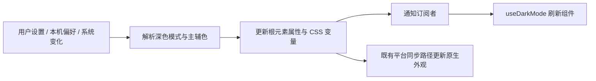

# 主题与深色模式

theme.js 保存颜色解析、对比色、默认值、系统偏好与主题应用函数；useDarkMode 订阅当前模式。App 将用户设置和本机选择应用到 CSS 变量，业务只读变量或使用既有辅助函数。

CSS 变量配合 hook 能让 DOM 与绘图逻辑共享当前主题；对照每组件保存独立色值，可减少不同步。案例（待独立测试）：THM-C01 有效/无效颜色回退；THM-C02 跟随系统与手动模式切换；THM-C03 切账号后旧主题不污染新设置；THM-C04 contrast 选择符合当前函数规则。浏览器集成会应用主题，但不是完整数学与持久化测试，见 THM-01 的 [清单](../../../doc/HISTORY_AND_TODO.md)。
